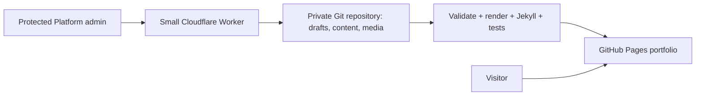

# R. Barela portfolio — execution plan

Original scope and design plan, prepared November 17, 2026. **Implementation update:** the local portfolio and editor are now built; see [README.md](README.md) and [TASK.md](TASK.md). The shared editor prerequisite shipped as Platform v0.50.0. The implementation uses one versioned JSON catalog instead of separate YAML/front-matter stores, retaining the planned Jekyll, Cloudflare and Git architecture. Production services have not been provisioned for this portfolio. The proposal below is retained as the original planning record.

**Recommendation:** Build a Jekyll portfolio with a small, protected Cloudflare admin using Dust Wave Platform. Keep public pages static, content versioned in Git, and editorial tools shared through Platform. Start from the lean Body and Blood build/deploy pattern, use Zema's media and protected-admin experience, and follow Nob Hill's Platform integration conventions.

**Confirmed scope**

- Public identity: **R. Barela**; art, makeup, props, sets, and filmmaking receive equal weight.
- Approximately 20 projects. Use clearly identified dummy projects and placeholder artwork during development; real material exists for a later content pass.
- R. Barela must be able to create and edit projects, categories, tags, and future posts in a browser, using the Dust Wave block editor.
- Upload web-ready photographs; use YouTube/Vimeo links for video. Prepare camera originals and large video files separately.
- No posts at launch. Prepare the shared article layout and editor support; show the Journal navigation only after a post is published.
- A domain exists but its name is not yet known. A launch date has not been set.
- Public contact link, Instagram, and IMDb belong in About/Contact. Keep the supplied IMDb URL as a credits reference; confirm actual credits with R. Barela before publishing them.

**Design and information architecture**

The Dare supplies the visual language: white background, black text, substantial Helvetica-style typography, close heading spacing, underlined links, generous whitespace, and prominent images. Its live embedded page currently computes its main headings at Helvetica 600, 50px/62.5px with -2px tracking, and navigation at 18px/22.5px. These are reference observations, not fixed sizes for this portfolio. Begin with a system Helvetica/Arial/sans-serif stack and responsive sizing.

The attached Creative Independent package supplies the organization: visible category navigation, clear selected states, an archive that leads into individual entries, and article pages with a title/deck, metadata, reading column, figures, and related work. Its documented reading widths of 640–700px are useful starting points. Use The Dare's sans-serif typography throughout this adaptation. The attachment's reproduction directions remain reference material; its text, illustrations, and brand assets are not portfolio content.

| Surface | First-release behavior |
| --- | --- |
| Home / All work | R. Barela wordmark; About and Contact; category links; a curated grid of approximately 20 projects. Images, project names, roles, and year stay visible. |
| Categories | Initial labels: Art, Makeup, Props, Sets, Film. R. Barela can create more, rename labels, and reorder navigation. Category pages are generated from saved content. |
| Tags | Secondary descriptors such as materials, techniques, or project type. Clickable on project pages; generated tag archives. |
| Project | Title, short introduction, year and explicit credited role, lead image, block content, credits, optional film link/player, and related projects. |
| About / Contact | Editable short biography, optional portrait, contact email, Instagram, IMDb. Start with an email link. |
| Journal | Uses the same block model and reading components, with publication date and related projects. Navigation remains absent while there are no published posts. |

Projects may belong to multiple categories and tags while retaining one canonical URL. Categories are broad ways into the portfolio; tags add detail. Store IDs and stable slugs separately from editable labels. Renaming a label preserves its URL. Prevent deletion of a category or tag still in use until entries are reassigned. Empty categories remain available in the admin and stay out of public navigation.

On mobile, keep the five initial discipline links visible and allow wrapping. Use one grid column on small screens, two at intermediate widths, and three when space allows. Keep the masthead compact enough to reveal work quickly. Project metadata stacks above a comfortable reading column; photography can extend beyond the text width. All core navigation uses real links and works without JavaScript.

**Reuse map**

| Source | Reuse and adaptation |
| --- | --- |
| Body and Blood | Jekyll/Liquid/SCSS structure, metadata includes, production build, shared CI verification action, Pages deployment, accessibility and publication checks. Replace book-specific assumptions in the templates and publication guard. |
| Zema | Poster-first, click-to-load film presentation; accessible media fallbacks; restricted editorial paths; repository-scoped GitHub App and protected Worker patterns. |
| Nob Hill | Platform submodule and manifest conventions, build-time preparation, minification, browser checks, and separate static-site/Worker releases. |
| Store and Pool | Both existing block-editor implementations and their characterization tests. Compare their consumer adapters before identifying any additional shared extraction. |
| `admin-shell` | Rich-text editor and codec, media selection/removal and upload identity, preview cache, dirty controls, unsaved-change protection, draft-baseline recovery, confirmations, API client, and readable feedback. |
| `worker-core` | Bounded HTTP and request handling, GitHub transport, provider timeouts, and safe logging. Portfolio adapters retain authorization and publishing decisions. |
| `media-core` | Safe media paths, dimensions, catalog and responsive-derivative planning. Local build steps own image conversion. |
| `design-core` | Relevant layout, focus/form, and editor-containment styles, with this site's own typography and tokens. |
| `site-shell` | Applicable navigation and accessibility announcements. Import only entries exercised by the site. |
| `build-core`, `test-core`, `release-core` | Asset minification, pin checks, overflow/docs helpers, and applicable dependency/release verification. |

Use an immutable Platform release with exact package versions and a checked submodule pin. Nob Hill's currently checked-out v0.44.0 pin predates some inspected Platform capabilities; do not copy that pin blindly. Choose and verify the release during implementation. Shared behavior belongs in Platform; portfolio taxonomy, templates, routes, and credentials belong in this repository.

**Block-editor work that is actually needed**

Platform currently exports `mountRichTextEditor`, the rich-text codec, media controls, draft recovery, and other editor primitives. Both Store and Pool use block editors, with additional composition logic still in each consumer's `assets/js/admin-dashboard.js`. Store defines its block types, normalization, rendering, insertion, and `createStoreProductDescriptionEditor` locally, and imports Platform's media controls and other admin helpers. Pool likewise retains block composition and campaign-specific integration. The abstraction is partial; the current Platform exports do not provide the full multi-block composer as one mountable component. This was checked against current Platform main (`126069a`) and the local consumer implementations on November 17, 2026.

The first engineering task is to compare Store and Pool's editor adapters against the existing Platform exports, then identify the smallest additional shared composition API needed by the portfolio. Reuse what is already abstracted. Where common composition code needs extraction into `admin-shell`, inject block types, labels, upload callbacks, save callbacks, and preview hooks; keep product, campaign, fundraising, and email behavior in the consumers. Characterize both existing implementations before moving code, preserve their differences through thin adapters, and test every affected consumer plus the portfolio harness. Release any required Platform addition and pin the portfolio to it. Do not import another consumer's application files directly or maintain a third copied editor.

Expose these blocks in the portfolio: text/headings/lists/links, quote, image, gallery, YouTube/Vimeo video, and divider. Support insertion, reordering with accessible controls, removal, undo, captions, image descriptions, and preview. Use the same composer for projects and posts. The initial release has no need for arbitrary HTML, arbitrary iframe embeds, local video uploads, or additional editor modes.

**Content and publishing architecture**

Recommended ownership:

- `_data/profile.yml`: identity, biography, contact, social links, and default sharing metadata.
- `_data/taxonomy.yml`: category/tag IDs, stable slugs, labels, and category ordering.
- `_projects/<slug>.md`: project metadata, taxonomy references, cover, credits, display order, and ordered `long_content` blocks compatible with the existing editor vocabulary.
- `_posts/`: future posts using the same block schema; no dummy posts need to be public.
- `_editor/`: saved working copies and staged media, explicitly excluded from the public artifact.
- `assets/media/`: published web-ready images and their generated responsive derivatives.
- `_layouts/`, `_includes/`, and a small build generator: shared shell, cards, block presentation, and automatically generated category/tag routes. Creating a category must not require a developer to add a page.
- `admin/` and `worker/`: the small portfolio-specific editor adapter and server endpoints.

Git is the durable content store. A browser recovery copy is supplementary. Use a private repository for unpublished text and staged media. Verify the account's GitHub Pages entitlement before provisioning: Pages from private repositories requires a supported paid GitHub plan. If that entitlement is absent, revisit static hosting at that point; retain the Jekyll build and private content repository.

The Worker serves the editor and its API under one protected origin. Use Cloudflare Access for the two approved editors, with verified identity at the Worker boundary and protection covering alternate and preview routes. Adapt Zema's repository-scoped GitHub App approach; credentials stay in Worker secrets. The public site does not fetch content from this Worker.

R. Barela's workflow is **New project → choose/create categories and tags → add blocks and photos → Save draft → Preview → Publish**. Save writes a durable working copy. Publish validates the complete candidate, verifies its base revision, and promotes content/taxonomy/media coherently through a Git commit. Concurrent edits produce a conflict while preserving the draft. Use immutable media names so replacements do not break the current site. Saving a draft must not publish staged photos.

The release workflow builds and tests the candidate before deployment. Show distinct admin states for saved, publishing, live, and failed; associate the live result with the exact deployed commit. Failure preserves the prior live site and the saved working copy. Extend the existing GitHub adapters only where needed for coherent multi-file publication and deployment status; those are implementation tasks, not capabilities to assume from `worker-core` alone.

Use one portfolio block-validation/rendering contract in the server preview and build pipeline, with shared fixtures proving equivalent output. Reject unsupported markup and video hosts. The trusted preview stays protected. Generate publication output only from published entries and referenced media; draft paths must be absent from the artifact.

**Execution sequence**

| Step | Concrete deliverable | Completion check |
| --- | --- | --- |
| 1. Prove reuse and pinning | Compare Store and Pool adapters with current Platform exports; build a small editor harness; extract only missing common composition behavior; select the release pin. | Text formatting, galleries, ordering, applicable undo/recovery behavior, and stale-upload handling retain their existing contracts in every affected consumer and work in the portfolio harness. |
| 2. Build the public prototype | Shared templates, responsive visual system, five initial categories, generated tag/category pages, About/Contact, and 20 labeled dummy projects. | Desktop/mobile review demonstrates the requested combination of references; cross-category projects have one canonical page. |
| 3. Connect the editor | Protected admin, project/post CRUD, taxonomy management, web-ready image upload, durable drafts, preview, and publish status. | An editor creates a category and project, reloads a saved draft, publishes it, and finds the correct new navigation and page. |
| 4. Verify the full release | CI checks, publication exclusions, responsive media, browser/Worker tests, and rollback procedure. | Failed publish leaves live content intact; stale saves preserve edits; unauthorized requests fail; no private drafts or dummy content reach production. |
| 5. Prepare launch | Replace fixtures with approved project material, verify roles/credits, set the domain and contact information, and rehearse editing with R. Barela. | Correct domain/HTTPS/canonical links, accessible galleries/video, verified deployment, and one successful owner edit through to the live site. |

Suggested appetite: one two-week engineering window for a working public prototype and owner editor, followed by a separately scheduled content/launch pass. This is a proposed scope budget, not a delivery promise; validate it after the editor extraction harness. If extraction exceeds the initial exploration window, revise the milestone timing explicitly. Preserve the requested block editor, owner-managed taxonomy, and reliable saves; defer decorative polish and extra block types first.

**Verification that matters**

- Editor round trips preserve formatting and block order; removed/reordered targets cannot receive stale upload results.
- Saved drafts survive reloads; local recovery never silently replaces a newer server revision. Save, Preview, and Publish have distinct effects.
- Category/tag changes update navigation and archives without orphaning references or breaking existing URLs.
- Worker authorization, bounded uploads, server-side block validation, conflict handling, and publication status are covered by focused tests.
- Public browser checks cover 320px mobile through desktop, keyboard focus, overflow, image sizing, missing media, links, reduced motion, and click-to-load video. Include a Safari/manual accessibility pass before launch.
- Production checks reject demo fixtures and exclude draft/admin/tooling files. Per-page canonical/social metadata and sitemap entries come from the same content model.
- An end-to-end rehearsal proves editor upload/save/publish, the matching CI run, the deployed page, and rollback. Local tests alone do not establish this.

**Scope boundary and remaining inputs**

The first release needs the public portfolio, editable taxonomy, the shared block editor, durable drafts, web-ready media, and publishing. Leave search, shopping, visitor accounts, newsletters, comments, Instagram synchronization, raw-camera ingestion, custom animation systems, and automatic video processing for a demonstrated need. Use a contact email link initially.

Before connecting services and replacing fixtures, obtain the existing domain/DNS access, R. Barela's login email, public contact email, approved biography and credits, and the chosen launch material. These do not prevent the local prototype. The Instagram and IMDb pages could not be read reliably during this review, so no biography, role, or project credit was inferred from them.

Planning score under the 37signals-way scope criteria: **8/10**. The brief, reuse boundaries, and first-release exclusions are defined. Confirming the time appetite and proving the shared composer extraction are the remaining improvements needed before treating this as a fully shaped build.

**Inspected references**

- [The Dare](https://www.itsthedare.com/) and its [current embedded presentation](https://link.fans/the-dare): visible layout and computed typography inspected in the browser.
- [Creative Independent reference package](/Users/aindaco1/Desktop/27-the-creative-independent/design-reference.md): archive, category navigation, article structure, and desktop/mobile screenshots.
- [Body and Blood architecture](../body-and-blood-landing/docs/ARCHITECTURE.md), [Zema architecture](../zema-landing/docs/ARCHITECTURE.md), and [Nob Hill architecture](../nob-hill-chile-drop/docs/ARCHITECTURE.md): local docs and relevant implementation inspected. Zema's operations guide explicitly records deferred end-to-end raw-upload acceptance; this plan does not depend on that pipeline.
- [Platform admin-shell](../dust-wave-platform/packages/admin-shell/README.md), [editor implementation](../dust-wave-platform/packages/admin-shell/src/editor.js), and [consumer adoption](../dust-wave-platform/docs/consumer-adoption.md).
- [Pool editor](../pool/assets/js/admin-dashboard.js), [dashboard behavior](../pool/docs/DASHBOARD.md), and [editor regression tests](../pool/tests/unit/admin-dashboard-editor.test.ts).
- [Store editor](../store/assets/js/admin-dashboard.js), [Platform script imports](../store/_layouts/admin.html), and [dashboard behavior](../store/docs/DASHBOARD.md).
- [Cloudflare Access for Workers](https://developers.cloudflare.com/workers/configuration/cloudflare-access/) and [GitHub Pages availability](https://docs.github.com/en/pages/getting-started-with-github-pages/what-is-github-pages).
- User-supplied identity links: [Instagram](https://www.instagram.com/r._barela/) and [IMDb](https://www.imdb.com/name/nm15080135/).
