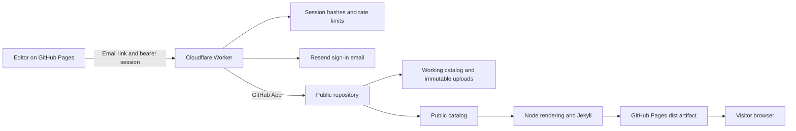

# Architecture

**Audience:** developers, maintainers, and reviewers.

## System boundary

The public portfolio is static HTML, CSS, images, and JavaScript. There is no visitor database or client-side router. Node validates the catalog, renders pages, prepares media, and stages a Jekyll source tree. Jekyll emits the static artifact. The hosted editor’s D1 database holds authentication and rate-limit state, not portfolio content.

Local development replaces the hosted auth/storage layers with a loopback cookie and filesystem store. Both stores implement the contract consumed by the same API handler. Local publication does not traverse GitHub, D1, or Resend.

## Code map

| Location | Responsibility |
| --- | --- |
| [lib/content.mjs](../lib/content.mjs) | Validation, normalized blocks, escaping, URL/media contracts, reference collection, ordering |
| [lib/views.mjs](../lib/views.mjs) | Header/footer, archive/project/Writing/Bio templates, metadata |
| [assets/css/site.css](../assets/css/site.css) | Public layout and responsive rules |
| [assets/js/site.js](../assets/js/site.js) | Intent-loaded external players and gallery dialogs |
| [admin/admin.mjs](../admin/admin.mjs) | Portfolio forms, composer adapter, saves, previews, recovery, publication |
| [admin/session.mjs](../admin/session.mjs) | Hosted sign-in, bearer requests, authenticated media/blob lifetimes |
| [worker/api.mjs](../worker/api.mjs) | Bounded API requests and storage-independent operations |
| [worker/auth.mjs](../worker/auth.mjs) | Approved-email links, token hashes, transactional exchange, revocation |
| [worker/index.mjs](../worker/index.mjs) | Exact Origin gate, authentication, CORS, API/media dispatch |
| [worker/github-store.mjs](../worker/github-store.mjs) | GitHub App authorization, optimistic saves, atomic publication, release status |
| [scripts/local-store.mjs](../scripts/local-store.mjs) | Serialized local state writes, publication builds, artifact switching |
| [scripts/build.mjs](../scripts/build.mjs) | Explicit source staging, derivatives, Jekyll, hosted admin shell |
| [scripts/dev.mjs](../scripts/dev.mjs) | Separate public/admin loopback servers and local media delivery |
| [lib/video-response.mjs](../lib/video-response.mjs) | MP4 byte ranges and HEAD responses |

## Content and publication

The public source is `content/catalog.json`. The hosted working copy is `_editor/catalog.json`, containing `{catalog, basePublishedRevision}`. A draft save checks both working and public revisions and updates the working copy. Publish filters out draft-only entries, verifies referenced files using one complete repository tree inventory, then updates the public catalog and working baseline in one non-forced commit. An unchanged public catalog returns `unchanged` without a new release commit.

Local `.local/state.json` contains `{catalog, published}`. Saves are serialized and use an atomic temporary-file rename. Publication builds a candidate before moving the current artifact to `previous/` and switching `next/` to `live/`. Draft-only entries can make the local draft and published hashes differ even after a successful publication; treat revisions as opaque values, not a universal “dirty” test.

The build copies only referenced public media and the selected PDF, generates thumbnails, renders routes, then runs Jekyll over that staging tree. `_config.yml` does not exclude the repository’s private files by itself; the explicit staging step is the boundary. Never deploy the checkout root or bypass the build with a root-level Jekyll command.

The hosted admin shell is copied into `dist/admin/` with a public API origin and a login-first UI. It contains no session credentials or catalog data. The local admin bundle omits that hosted origin. Preview uses the public renderer but omits visitor scripts; hosted media paths are replaced with authenticated blob URLs before display.

## Shared Platform ownership

[platform.json](../platform.json) and the submodule commit pin the shared contracts. The portfolio imports:

- `media-core` reads a selected PNG header before the editor decodes it. The portfolio enforces the 40-megapixel limit and validates the file on upload.
- `admin-shell`: block composer/model, rich-text conversion and sanitization, media controls, API client, unsaved-change guard, and draft recovery.
- `worker-core`: bounded request/response readers, GitHub client, email preparation, and crypto helpers.
- `build-core`: asset minification.

Portfolio fields, routes, page design, authentication policy, and storage integration stay here. Public masonry/viewer behavior is currently portfolio-owned; the existing Dust Wave New implementation informed its approach, but Platform has no imported public-gallery module at this pin.

## Decisions and tradeoffs

| Decision | Reason and consequence |
| --- | --- |
| One small JSON catalog | Shared validation and simple atomic publication; concurrent edits conflict rather than merging automatically |
| One shared block editor | Projects, Writing, and Bio have consistent authoring without copied composer implementations |
| Static public site | Fast, low-maintenance delivery; dynamic editing lives behind a separate API |
| Public same-repository working copy | Simple GitHub integration; unpublished source and immutable uploads remain publicly visible in repository history |
| Web-ready uploads | Keeps the editor small; original preparation, transcoding, and editorial review happen separately |
| Native gallery enhancement | Retains useful no-script links and avoids a new dependency; editor previews remain script-free |
| D1 for sessions only | Content remains versioned in Git; session recovery and content recovery are different operations |

See [API](API.md) for request/security contracts and [Operations](OPERATIONS.md) for recovery and concurrent-edit handling.
